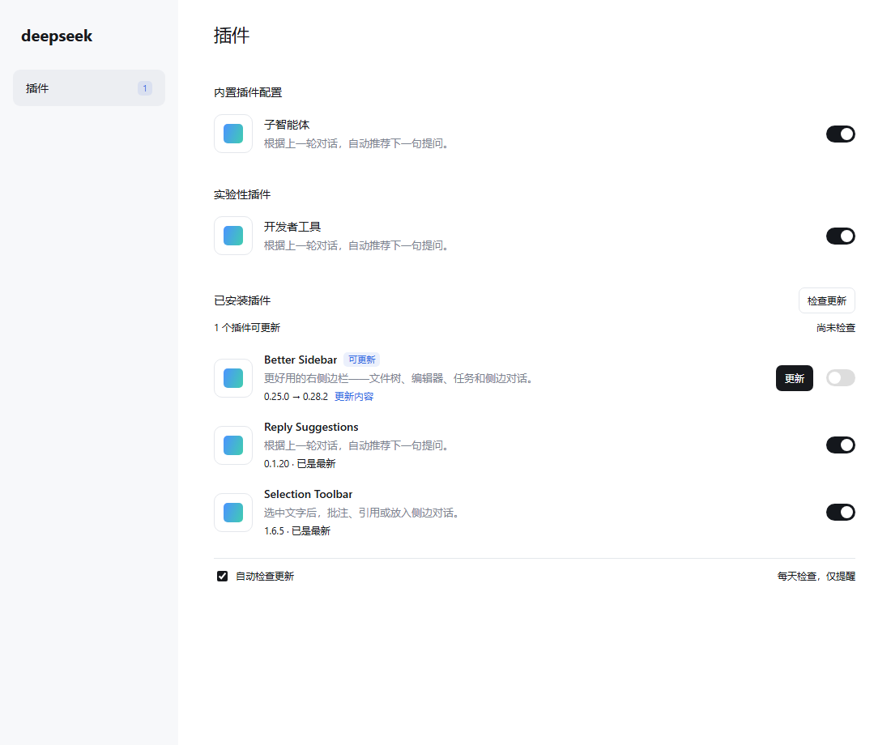

# Plugin Updater

[简体中文](./README.md) · **English**

Find new plugin versions and update when you choose.

A plugin update checker for [DeepSeek Harness](https://github.com/deepseek-ai/deepseek-harness). It checks plugins you added in the Installed plugins group, then shows version differences, update actions and a sidebar count.

| Item | Current version / requirement |
| --- | --- |
| Plugin | `0.1.0` (package: `dsh-plugin-updater`) |
| DSH | `0.2.1-rc.5` (official desktop app) |
| License | [MIT](./LICENSE) |

## Features

- **Check for updates**: check from the Installed plugins group header and see the last check time.
- **Update indicators**: available updates show a badge and `installed version → target version`. The Plugins sidebar entry shows their count.
- **Update on demand**: update a plugin from its row. Its detail page shows versions, update information and the release source.
- **Automatic checks**: check every 24 hours by default and notify you. You decide when to install. Turn automatic checks off at the bottom of the group.
- Disabled plugins are checked too. Updates preserve each plugin's enabled or disabled selection.
- Failed installations attempt to restore the previous version. Restart requirements, incompatibility and check failures are shown separately.

Checks cover user-installed plugins. Built-in plugins and experimental plugins supplied with DSH are excluded. Automatic checks pause while DSH is closed and catch up on startup. A failed check is retried automatically no sooner than one hour later; manual checks remain available.

## Demo



Captured from a test page running the actual `0.1.0` plugin client and DSH `0.2.1-rc.5` components. The plugin list is test data, not a recording of the desktop app.

## Install

### From GitHub

1. Open DSH's **Plugins** page and check whether `dsh-plugin-updater` is already installed. Maintain the existing source instead of adding a duplicate.
2. Confirm that the official desktop app is `0.2.1-rc.5`.
3. Click **Add plugin** and enter this repository address:

   ```text
   https://github.com/jabingu/dsh-plugin-updater
   ```

4. Follow the app's instructions and choose **立即启用** (Enable now). Fully quit and reopen DSH if it requests a restart.
5. Scroll to **已安装插件** (Installed plugins) and check that **检查更新** (Check for updates) appears.

The repository includes built `lib/` files, so no local build is needed to install. Distribution is through GitHub, local directories or package archives, not the npm registry.

### From a local directory

1. Open DSH's **Plugins** page and check whether `dsh-plugin-updater` is already installed. If it is linked locally, update that directory instead of adding it again.
2. Confirm that the official desktop app is `0.2.1-rc.5`.
3. Click **Add plugin** and enter the absolute path of the directory containing this plugin's `package.json`.
4. Follow the app's instructions and choose **立即启用** (Enable now). It took effect immediately in the local desktop check. If the app requests a restart, fully quit and reopen DSH.
5. Scroll to **已安装插件** (Installed plugins) and check that **检查更新** (Check for updates) appears.

DSH's package manager handles runtime dependencies.

For a linked installation, update the original directory, rebuild and restart DSH to load the changes. Reinstalling is unnecessary. Maintain the checker itself this way; it will not uninstall itself while processing an update request.

### From a package archive

Enter the absolute path of `dsh-plugin-updater-0.1.0.tgz` in the same Add plugin dialog, then install and enable it. Check for an existing installation first.

The desktop app manages its own profile; use its plugin page. If you use `dsh web`, run from the plugin directory:

```powershell
dsh plugin --profile web list --depth=0
# Add only after confirming it is not installed:
dsh plugin --profile web add .
```

## Example

Suppose Better Sidebar `0.25.0` is installed:

1. Open **Plugins → Installed plugins** and click **检查更新** (Check for updates) beside the group title.
2. If compatible version `0.28.2` is found, its row shows an update badge, `0.25.0 → 0.28.2` and an **更新** (Update) button. The sidebar count increases.
3. Select **更新内容** (Update information), or open the plugin's detail page to inspect its source.
4. When ready, choose **更新** (Update) and wait for the result. Restart only when requested.

Automatic checks run daily by default. A check does not install a new version.

### Supported installation sources

| Source | Behavior |
| --- | --- |
| npm package / version range | Query the registry for compatible stable releases and install an exact version. |
| Public GitHub repository | Check stable Releases, or a branch/default branch when none exist. Pin the update to a commit SHA. |
| Local directory, `link:`, `file:` | Show a manual-maintenance message; update the original directory or file yourself. |
| npm alias, other Git hosts, archive URL | Show an unsupported-source message and keep the current installation. |

A manual-maintenance message for a linked plugin means its source directory owns its updates; it does not mean the checker failed to install. See [update behavior](./docs/update-behavior.md) for version selection, recovery and data storage details (Chinese).

## Development and verification

Use Node.js 22.19.0 or later within 22.x, or Node.js 24 or later, and run from the project directory:

```powershell
# List installed dependencies first:
npm ls --depth=0
# Install only after confirming required dependencies are missing:
npm install --ignore-scripts
npm run build
npm test
```

All **62 automated tests pass**, covering plugin scope, npm/GitHub sources, compatibility, daily scheduling, settings persistence, recovery, enablement and page cleanup. Actual DSH components and Chrome were also used to check desktop and narrow layouts.

The checker has been installed, enabled and used to discover updates in the official `0.2.1-rc.5` desktop app. The group action, sidebar indicator and automatic-check setting were verified. Real plugin replacement, activation after restart and recovery on restricted networks still require verification. See the [verification record](./docs/verification.md) (Chinese).

`lib/` is generated from `src/` and `scripts/build.mjs`; do not edit it by hand. `npm test` checks build consistency before running tests.

To verify local DSH components and browser behavior:

```powershell
node scripts/read-dsh-asar.mjs dsh-client-ui-plugin-manager dsh-client-ui-sidebar dsh-plugin-manager
npm run verify:sdk
npm run test:browser
```

Set `DSH_ASAR` to a local app archive and `CHROME_PATH` to an installed Chromium browser when needed. These scripts use test pages and save their output in `work/`.

## License

[MIT](./LICENSE).
