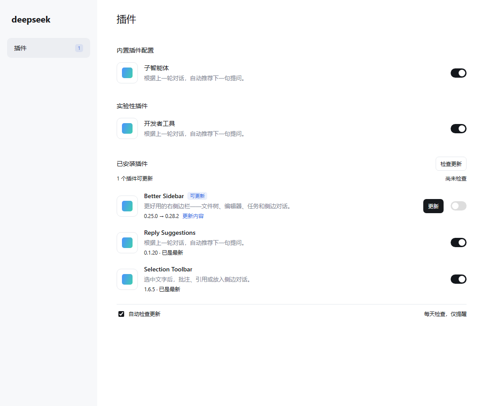

# Plugin Updater

**简体中文** · [English](./README.en.md)

查看插件有没有新版，按需更新。

一个为 [DeepSeek Harness](https://github.com/deepseek-ai/deepseek-harness) 提供插件更新检查的插件。在“已安装插件”分组中检查自行下载的插件，发现新版后显示版本差异、更新按钮和侧栏提醒。

| 项目 | 当前版本 / 要求 |
| --- | --- |
| 插件 | `0.1.6`（包名：`dsh-plugin-updater`） |
| DSH | `0.2.1-rc.5`，或 `0.2.2` 系列自 `rc.1` 起（官方桌面版） |
| 许可证 | [MIT](./LICENSE) |

## 功能

- **检查更新**：在“已安装插件”标题右侧检查新版，并显示上次检查时间。
- **更新提示**：有新版的插件显示“可更新”和“当前版本 → 新版本”；左侧“插件”入口显示可更新数量。
- **按需更新**：点击对应插件的“更新”，详情页可查看版本、更新信息和发布来源。
- **自动检查**：默认每 24 小时检查一次，只提醒，由你决定何时安装。可在分组底部关闭自动检查。
- 已关闭的插件也参与检查；更新保留原来的启用或关闭状态。
- 安装失败时尝试恢复旧版本；需要重启、暂不兼容或检查失败时，分别显示原因。

仅管理自行安装的插件，内置插件和随 DSH 提供的实验性插件不参与检查。DSH 关闭期间暂停自动检查，启动后补检查；检查失败后最早 1 小时再自动重试，手动按钮仍可使用。

DSH 支持原生更新的插件在详情页使用原生更新入口；其他来源和旧版宿主使用更新器入口。两套检查的加载顺序不会增加重复的详情按钮或“可更新”标签。

`0.1.3` 的总览更新会在宿主支持时调用 DSH 原生更新流程。任务进行时可在插件行或分组标题旁点击“停止更新”，等待 DSH 确认取消和恢复结果；进入生效阶段或恢复阶段时显示对应原因。停止请求 15 秒未确认后可重试。

## 演示



这张图来自加载真实 `0.1.0` 插件客户端与 DSH `0.2.1-rc.5` 组件的测试页面。插件列表为测试数据，非 DSH 桌面实录。

## 安装

### 从 GitHub 安装

1. 打开 DSH 的 **插件** 页面，先检查是否已安装 `dsh-plugin-updater`。已有安装时维护原来源，避免重复添加。
2. 确认官方桌面版为 `0.2.1-rc.5`，或 `0.2.2` 系列中 `rc.1` 及后续版本。
3. 点击 **添加插件**，在“包名或地址”中填写：

   ```text
   https://github.com/jabingu/dsh-plugin-updater
   ```

4. 按应用提示完成安装并点击 **立即启用**。如应用提示需要重启，完全退出并重新打开 DSH。
5. 滚动到 **已安装插件** 分组，确认出现 **检查更新**。

仓库包含构建好的 `lib/`，安装前无需自行构建。本包通过 GitHub、本地目录或安装包分发，不通过 npm registry 发布。

### 从本地目录安装

1. 打开 DSH 的 **插件** 页面，先检查是否已安装 `dsh-plugin-updater`。本地链接已存在时更新原目录，避免重复添加。
2. 确认官方桌面版为 `0.2.1-rc.5`，或 `0.2.2` 系列中 `rc.1` 及后续版本。
3. 点击 **添加插件**，在“包名或地址”中填写包含本插件 `package.json` 的目录绝对路径。
4. 按应用提示完成安装并点击 **立即启用**。本机验证可立即生效；如应用提示需要重启，再完全退出并重新打开 DSH。
5. 滚动到 **已安装插件** 分组，确认出现 **检查更新**。

运行时依赖由 DSH 的包管理器处理。

更新已链接目录中的文件并重新构建、重启 DSH 后即可加载修改，无需重复安装。检查器自身使用这套方式维护，不会在处理更新请求时卸载自己。

### 从安装包安装

在同一添加入口填写 `dsh-plugin-updater-0.1.6.tgz` 的绝对路径，再按应用提示安装并启用。安装前同样先检查是否已有同名插件。

官方桌面 profile 由应用管理，请使用桌面插件页面。确实使用 `dsh web` 的用户可在插件目录执行：

```powershell
dsh plugin --profile web list --depth=0
# 确认尚未安装后再添加：
dsh plugin --profile web add .
```

## 使用示例

假设已安装 Better Sidebar `0.25.0`：

1. 打开 **插件 → 已安装插件**，点击标题右侧的 **检查更新**。
2. 若发现兼容版本 `0.28.2`，该行显示 **可更新**、`0.25.0 → 0.28.2` 和 **更新**，侧栏数量增加。
3. 点击 **更新内容** 查看说明，或进入插件详情查看来源。
4. 决定升级时点击 **更新**，等待结果；需要重启时按提示操作。

默认每天自动执行检查。未点击更新时，不安装新版本。

### 支持的安装来源

| 来源 | 处理方式 |
| --- | --- |
| npm 包名 / 版本范围 | 查询注册表，寻找兼容的稳定版本，安装时指定精确版本。 |
| GitHub 公共仓库 | 检查稳定 Release；没有稳定 Release 时读取分支或默认分支。更新目标固定为提交 SHA。 |
| 本地目录、`link:`、`file:` | 显示手动维护提示，由你更新原目录或文件。 |
| npm 别名、其他 Git 主机、压缩包地址 | 显示暂不支持，保留已有安装。 |

本地链接插件显示“需手动处理”表示它由原目录维护，并不代表检查器安装失败。详细的版本选择、失败恢复和数据保存规则见 [更新行为说明](./docs/update-behavior.md)。

## 开发与验证

使用 Node.js 22.19.0 或更新的 22.x，或 Node.js 24 及以上版本，在项目目录执行：

```powershell
# 安装前先检查已有依赖：
npm ls --depth=0
# 确认缺少所需依赖后再安装：
npm install --ignore-scripts
npm run build
npm test
```

当前 **79 项自动化测试通过**，覆盖插件范围、npm / GitHub 来源、兼容性、每日调度、设置保存、失败恢复、启停状态和页面清理。另使用真实 DSH 组件及 Chrome 检查了普通和窄窗口布局。

`0.2.2-rc.2` 已使用官方组件通过兼容性与浏览器验证。`0.1.5` 的版本范围涵盖后续 `0.2.2` 候选版与正式版，这些版本的运行验证待官方发布。

已在本机官方桌面版 `0.2.1-rc.5` 和 `0.2.2-rc.1` 中启用并完成新版检查，验证了总览按钮、侧栏提示和自动检查设置。`0.1.1` 修复宿主升级后的兼容性拦截，并支持 Cordis `4.1.0`。真实插件的版本替换、重启激活及受限网络下的恢复仍需验证，详见 [验证记录](./docs/verification.md)。

`lib/` 由 `src/` 和 `scripts/build.mjs` 生成，请勿手动修改。`npm test` 会先检查构建产物与源码是否一致，再运行测试。

本机 DSH 组件与浏览器验证：

```powershell
node scripts/read-dsh-asar.mjs dsh-client-ui-plugin-manager dsh-client-ui-sidebar dsh-plugin-manager
$env:DSH_SDK_VERSION = '0.2.2-rc.1'
npm run verify:sdk
npm run test:browser
```

`DSH_ASAR` 可指定本机应用归档，提取结果按实际 DSH 版本保存。`DSH_SDK_VERSION` 选择已提取的组件版本，`CHROME_PATH` 可指定已安装的 Chromium 浏览器。这些验证脚本使用测试页面，产物保存在 `work/`。

## 许可证

[MIT](./LICENSE)。
